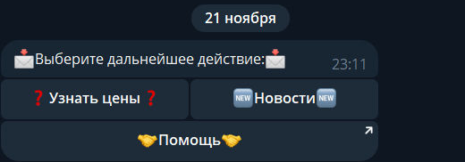
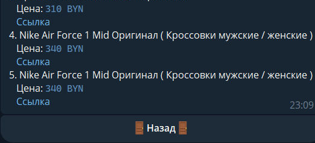
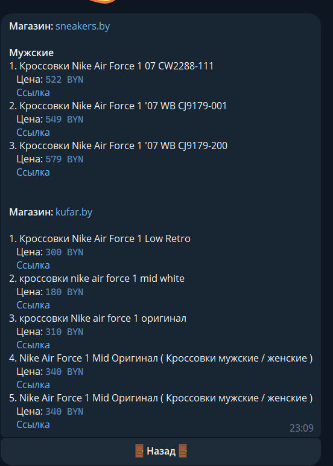

# SneakerCheckPriceBot

Telegram-бот, который ищет и сравнивает цены на кроссовки в нескольких
магазинах и присылает свежие новости из мира кроссовок. Асинхронный, готов к
запуску в Docker, достаточно компактный, чтобы прочитать целиком.

[English version](./README.md)


[](https://github.com/Nikita-Pugach/SneakerCheckPriceBot/actions/workflows/tests.yml)

## Скриншоты



| Выбор бренда | Результаты |
|---|---|
|  |  |

## Что умеет

- **Проверка цен** — ищет по нескольким магазинам и показывает подходящие
  предложения с ценами и ссылками.
- **Пошаговый поиск** — вместо одного текстового запроса бот ведёт диалог
  бренд → модель → размер (FSM в aiogram), на каждом шаге есть кнопка
  «посмотреть всё».
- **Новости** — свежие заголовки за последние N часов из RSS-ленты.
- **Проверка подписки** — меню открывается только подписчикам канала.
- **Меню на кнопках** — запоминать нужно только `/start`.

Сценарий «заказ кроссовок» (ссылка на магазин-партнёр) запланирован, но пока не
реализован.

## Источники

| Магазин | Как читается |
|---|---|
| bunt.by | страницы каталога, затем страница товара ради цены |
| sneakers.by | страницы каталога, затем страница товара ради цены |
| kufar.by | публичный JSON API поиска, цена приходит вместе с выдачей |

Kufar — это объявления, а не магазин: состояние и цены там разные, он добавлен
ради охвата. Новый магазин — это модуль в `sneaker_bot/parsers/` с функцией
поиска и извлечением цены.

### Политика обхода

Бот читает только страницы каталога, листает их тем способом, который разрешён
магазином, делает паузы между страницами, держит не больше шести страниц товаров
одновременно и представляется честным User-Agent. В `robots.txt` обоих
магазинов поисковые адреса запрещены — бот их не вызывает. Ответ 403 уважается,
а не обходится headless-браузером.

## Как устроен поиск

```
/start → проверка подписки → главное меню
                                 │
                    ┌────────────┴────────────┐
                 Цены                     Новости
                    │                         │
        бренд → модель → размер      за последние N часов
                    │                         │
             парсинг магазинов → предложения  заголовки
```

Состояния — `aiogram.fsm`. Парсинг — `aiohttp` + BeautifulSoup, отдельный модуль
на магазин: чтобы добавить магазин, достаточно одной функции и её регистрации.

## Стек

| Слой | Выбор |
|---|---|
| Язык | Python 3.12 |
| Фреймворк бота | aiogram 3.x |
| HTTP и парсинг | aiohttp, BeautifulSoup, lxml |
| Новости | feedparser |
| Конфигурация | python-dotenv |
| Пакеты | Poetry |
| Запуск | Docker (python:3.12-slim) |

## Быстрый старт

```bash
git clone https://github.com/Nikita-Pugach/SneakerCheckPriceBot.git
cd SneakerCheckPriceBot
poetry install
cp .env.template .env      # затем заполнить значения
poetry run python -m sneaker_bot.main
```

Понадобится токен от [@BotFather](https://t.me/BotFather) и канал, подписку на
который бот будет проверять.

## Конфигурация

Всё берётся из `.env` (см. [`.env.template`](./.env.template)):

| Переменная | Назначение |
|---|---|
| `SECRET_TOKEN_BOT` | Токен Telegram-бота |
| `ID_CHANNEL` | Канал для проверки подписки |
| `NEWS_URL` | RSS-лента для новостей |
| `LAST_HOURS` | За сколько часов собирать новости |
| `MAX_PAGES`, `MAX_PAGES_BUNT`, `MAX_PAGES_SNEAK`, `PER_CAT` | Глубина обхода парсеров |
| `USER_AGENT` | User-Agent для HTTP-запросов |
| `SNEAKERS_WOMEN_URL`, `SNEAKERS_MEN_URL` | Каталоги магазина |
| `BASE_URL`, `CATALOG_MEN_PATH`, `CATALOG_WOMEN_PATH` | Каталоги второго магазина |

Секретов в репозитории нет: `.env` игнорируется, в `.env.template` только
заглушки.

## Docker

```bash
docker build -t sneaker-bot .
docker run --rm --env-file .env sneaker-bot
```

Образ ставит зависимости из lock-файла и запускает `python -m sneaker_bot.main`.

## Структура проекта

```
sneaker_bot/
├── handlers/     роутеры команд и callback-кнопок
├── menu/         клавиатуры и тексты меню
├── parsers/      парсеры цен и новостей
├── services/     отправка сообщений, сборка текста, общая логика
├── setting.py    настройка бота и диспетчера
├── startup.py    регистрация команд
├── sub_checker.py проверка подписки
├── tasks.py      вспомогательные async-задачи
└── main.py       точка входа
```

## Частые вопросы

**Бот не запускается.** Проверьте `.env` — чаще всего забыт `SECRET_TOKEN_BOT`.
Затем убедитесь, что установлены Python 3.12 и Poetry.

**Как добавить магазин?** Добавьте функцию-парсер в `parsers/price_parser.py` и
вызовите её из сценария поиска.

**Как поменять меню или тексты?** Клавиатуры — в `menu/`, сообщения — в
`services/send_messages.py`.

## Авторы

- [Kirill](https://github.com/Kirill-Unix) — парсеры, обработчики, новости,
  исходный бот.
- [Nikita Pugach](https://github.com/Nikita-Pugach) — пошаговый поиск (FSM),
  исправления парсера цен, работа с конфигурацией, упаковка и документация.

## Лицензия

MIT. См. [LICENSE](./LICENSE).
